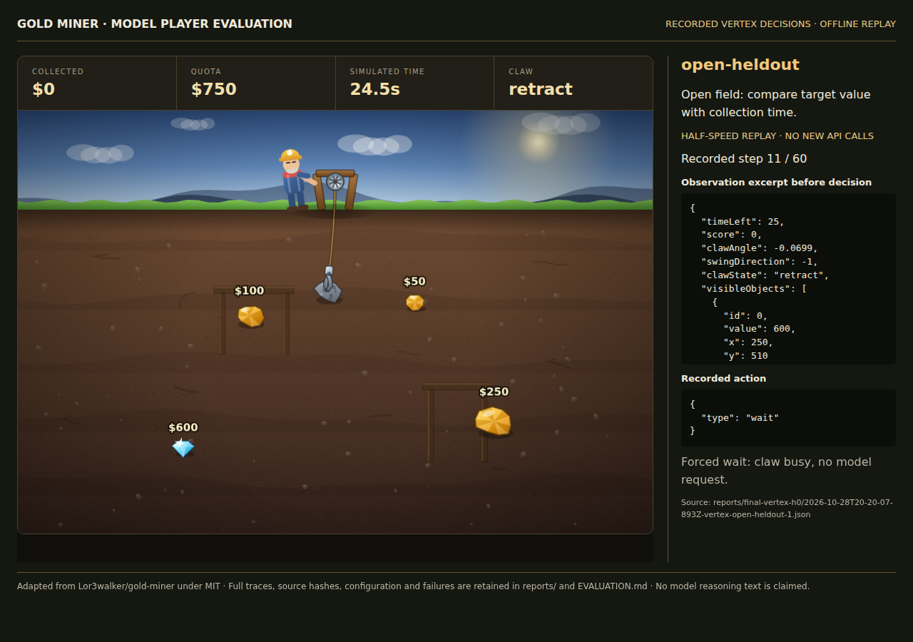

# Gold Miner — model-player evaluation

A bounded adaptation of [Lor3walker/gold-miner](https://github.com/Lor3walker/gold-miner), comparing model-selected launch timing with a geometry-based heuristic. The original claw physics, item definitions, and procedural artwork are reused under MIT. The pinned source, license, and file hashes are recorded in [SOURCE.json](SOURCE.json).

## Current status

- Playable browser game and five-operation engine implemented.
- Heuristic reaches the quota in all three development and all three held-out situations.
- All 34 deterministic engine, runner, replay, mocked adapter, timing-skill and evaluation-audit tests pass locally. Independent review evidence is in [review.md](review.md).
- **Final held-out evaluation is complete.** Twelve fresh Vertex episodes compare observation-only input and four-entry history. Gemini reached 2/6 quotas with H0 and 0/6 with H4. The heuristic reached all quotas. All 24 final traces, the original failed checkpoint and the $0.1994127 final token-cost estimate are retained in [EVALUATION.md](EVALUATION.md).
- The latest published [fork CI at 67c25ee passed](https://github.com/rogerwangdev/game-dev-f26/actions/runs/40728983100). Current work is committed locally only. No new remote CI or course PR is claimed. See the [local verification record](docs/verification.md) and [course integration status](docs/course-integration.md).

## Run locally

Use Node.js 22 or later and Python 3 for the static server. No npm dependencies are required for the game, tests, baseline or saved-trace audit. Live Vertex play also requires Google Cloud CLI (`gcloud`), funded project access, and application-default authentication. Video capture is an optional development tool with separate Playwright requirements.

From the repository root, enter this project once:

```bash
cd midterms/rogerwangdev
```

Run every command below from `midterms/rogerwangdev/`:

```bash
npm test
npm run verify-source
npm run check:timing
npm run audit:evaluation
npm run baseline
npm run serve
```

Open <http://127.0.0.1:8765>. Choose a situation and player. Start the clock for automatic play, or use **Wait 0.5 seconds** and **Launch claw** to inspect individual decisions. Space or Down launches and Right advances one interval. Download traces or replay an evaluation JSON file. Replays make no provider calls.

To watch the actual first Gemini run, open <http://127.0.0.1:8765/?replay=vertex> or click **Watch saved Gemini episode**. Use **Pause replay**, then **Next recorded step** to inspect each observation, returned action, latency, and result in the agent inspector. Automatic waits are labeled separately and make no model request. This recording ends with the actual failed $0/750 outcome. No new API calls are made when watching it.

## Recording

[Watch/download the 3½-minute WebM recording](recordings/gold-miner-demo.webm), or serve the project and open <http://127.0.0.1:8765/recording.html> for the interactive demonstration. [Capture provenance and reproduction](recordings/README.md) describe its selected traces, hashes and checks.

The recording replays real Vertex actions at half speed and labels that clearly. It shows the first observation-only trial of each held-out case, selected before results were known. It includes failures, numeric observation excerpts, returned actions, actual recorded latency and the full comparison. No person selects gameplay moves and no model calls occur while watching. This is recorded evaluation playback rather than a new live browser-connected agent.



The agent loop runs locally in `src/runner.js`. It sends visible numeric state and allowed actions to the existing Gemini model through `src/vertex.js`, validates the returned action, and advances the local engine. The game and runner have not been deployed to Google Cloud. Gemini receives structured game observations rather than a browser connection or screenshot. Opening the browser game does not start a live model episode.

## Scope and controls

One complete level format includes static gold, diamonds, rocks, quotas, and a simulated timer. Value is awarded after retrieval. A run ends when the field is cleared or time expires. Success means reaching the quota. Shops, upgrades, combos, dynamite, hidden-value bags, moving animals, and the original campaign are excluded to isolate timing and value/time decisions.

The shared engine uses 60 Hz physics and 30 frames per decision. An action is `{"type":"wait"}` or `{"type":"launch","frame":N}` for integer `N` from 0 to 29. A launch waits exactly N physics frames in the current interval before firing. Model thinking time does not advance the game. The runner advances forced waits without model calls while the claw cannot accept another launch. Both players use identical controls.

The authoritative engine exposes `reset(seed)`, `observe(player_id)`, `legal_actions(player_id)`, `step(player_id, action)`, and `outcome()`. Public numeric object properties support evaluation without a vision model. Players receive copied observations and have no engine handle, file-reading tools, credentials, or evaluator annotations.

The [rule/source map](docs/rule-source-map.md) distinguishes inherited rules from intentional adaptations. Our contribution is the fixed-step interface, bounded level scenarios, baseline, model adapter, runner, tests, traces, and English checkpoint interface.

## Run another live Vertex episode

These commands make paid API calls only when `--live` is present. Run from this project folder after configuring the project associated with your course credits and application-default credentials:

```bash
export GOOGLE_CLOUD_PROJECT='game-dev-f26-lw3240'
export GOOGLE_CLOUD_LOCATION='global'
export COURSE_MODEL='gemini-3.5-flash-lite'
gcloud auth application-default login
npm run evaluate -- --player vertex --live --suite development --scenario open-dev --trials 1
```

For existing application-default credentials outside the standard WSL directory, set `GOOGLE_APPLICATION_CREDENTIALS` to that local file. Do not copy credentials into this repository. The adapter reads an access token through `gcloud` and sends only public gameplay context to Vertex. It has no retry or heuristic fallback.

The default live limits are 60 calls, three invalid responses, 15 seconds per call, and 180 seconds per episode. Failed calls count. Use a small development episode first. Inspect the saved summary and trace, including failures, before broader evaluation.

The final evaluation has already run. The frozen [protocol](FINAL-EVALUATION.json), [audited results](reports/final-analysis.json) and [per-trial CSV](reports/final-results.csv) are included. To perform a new reproduction, use the same cases and two trials per situation. The two Vertex commands below make new paid requests. Separate output folders preserve the recorded final results:

```bash
npm run evaluate -- --player baseline --suite heldout --trials 2 --history 0 --output-dir reports/reproduction-baseline-h0
npm run evaluate -- --player baseline --suite heldout --trials 2 --history 4 --output-dir reports/reproduction-baseline-h4
npm run evaluate -- --player vertex --live --suite heldout --trials 2 --history 0 --output-dir reports/reproduction-vertex-h0
npm run evaluate -- --player vertex --live --suite heldout --trials 2 --history 4 --output-dir reports/reproduction-vertex-h4
```

Do not use held-out results to tune the prompt. [SUITE.json](SUITE.json) records the declared cases, budgets, and scenario hash before any live trials. [EVALUATION.md](EVALUATION.md) reports actual evidence and outstanding work.

## Development workflow and remaining submission work

Project instructions are in [AGENTS.md](AGENTS.md). The committed [gold-miner-rule-change skill](skills/gold-miner-rule-change/SKILL.md) connects design rationale, source evidence, failing tests, implementation, boundary checks, and independent review. Its [simulation-timing procedure](skills/gold-miner-rule-change/references/simulation-timing.md) explains changes such as 0.5-second to 1-second decisions and includes an offline `npm run check:timing` helper. The active game still uses 0.5-second decisions. Actual usage is recorded in [the work log](docs/work-log.md). The [agent-team evidence index](docs/agent-team-evidence.md) lists the remaining rubric work. [Two actual authoring-session transcripts](docs/sessions/README.md) document named skill use in the original VS Code implementation and a fresh standalone CLI timing rehearsal. The session files are ready for course PR links after publication is authorized.

Codex assisted with implementation and suggested wrapping the existing claw simulation rather than replacing timing with target selection. This suggestion was retained in the implementation. The student still needs to complete the one-page [AGENT-TEAM.md worksheet](AGENT-TEAM.md) in their own voice. [Peer fields](PEER-NOTES.md) remain intentionally blank. Final evaluation and the local recording are complete. Human experience and personal reflection are not inferred from automated checks. A [PR description draft](docs/PR-DESCRIPTION.md) is ready for the eventual authorized publication.

Original source: Lor3walker, revision recorded in SOURCE.json. Preserve [the imported MIT license](vendor/gold-miner/LICENSE). The upstream artwork is drawn procedurally by its code. This project is an independent adaptation and does not claim affiliation with the original Gold Miner publisher.
